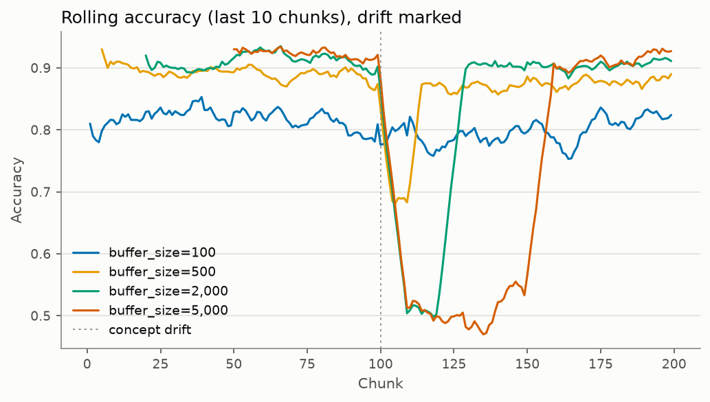

# NumCompute-Stream

P_AI Assignment 2.2, 2026 S2

Demo video link: [NumCompute-Stream demo](https://drive.google.com/file/d/1a1MS5fbZZIvNp1Wx2trBxgV1s7x14T49/view)

NumCompute-Stream extends NumCompute (Assignment 2.1) into a streaming machine learning toolkit built only on NumPy and matplotlib. Data arrives in chunks; every component learns from each chunk with `partial_fit` or `update` and keeps a bounded amount of state, so memory does not grow with the length of the stream. The model is a depth-limited decision tree that retrains on a buffer of recent rows.

The 2.1 README is archived in [docs/README_2.1.md](docs/README_2.1.md).

## Required structure

```text
NumCompute/
├── .gitignore
├── README.md
├── pyproject.toml
├── numcompute_stream/
│   ├── __init__.py
│   ├── io.py
│   ├── preprocessing.py            # + partial_fit
│   ├── sort_search.py
│   ├── rank.py
│   ├── stats.py                    # + StreamingStats
│   ├── metrics.py                  # + streaming metrics
│   ├── optim.py
│   ├── pipeline.py                 # + partial_fit, predict_proba, flush
│   ├── utils.py
│   ├── benchmarking.py
│   ├── tree.py                     # new: buffered decision tree
│   ├── stream.py                   # new: StreamTrainer
│   └── visualise.py                # new: plots
├── tests/
│   ├── README.md                   # how to run the tests, layout and conventions
│   ├── conftest.py                 # Agg backend, closes figures after each test
│   └── test_*.py                   # 18 test files (see Tests)
├── benchmark/
│   ├── loops.py                    # plain-Python baselines (2.1 and 2.2)
│   ├── run_benchmarks.py           # 2.1 runner, writes results.md
│   ├── results.md                  # latest 2.1 full run
│   ├── run_stream_benchmarks.py    # 2.2 runner, writes stream_results.md and figures/
│   ├── stream_results.md           # latest 2.2 full run
│   └── figures/
│       ├── rolling_accuracy.png
│       ├── retrain_time.png
│       └── accuracy_after_drift.png
├── demo/
│   ├── stream_demo.ipynb           # 2.2 demo
│   ├── generate_stream.py          # writes data/stream.csv
│   ├── quickstart.ipynb            # 2.1 demo
│   ├── generate_sample.py          # writes data/sample.csv
│   ├── data/
│   │   ├── stream.csv              # synthetic stream, 20,000 rows
│   │   ├── banknote.csv            # real data (see Datasets)
│   │   └── sample.csv              # 2.1 sample data
│   └── sample.csv                  # older 8-row example
└── docs/
    └── README_2.1.md               # archived 2.1 README
```

## Installation

Requires Python 3.10+, NumPy and matplotlib (no other runtime dependencies).

```bash
git clone https://github.com/jose-gomezc/NumCompute.git
cd NumCompute
git checkout jose
python -m venv .venv
.venv\Scripts\activate          # Windows; on macOS/Linux: source .venv/bin/activate
pip install -e ".[test]"        # editable install of numcompute_stream, plus pytest
python -m pytest                # run the test suite
```

To run the demo, also install the notebook kernel:

```bash
pip install -e ".[demo]"
```

Then open `demo/stream_demo.ipynb` and select the `.venv` interpreter as the kernel in your notebook editor.

## API overview and examples

The tables list the streaming APIs added in 2.2 and their key parameters, in the order of the assignment specification. Full signatures, validation rules and complexity notes are in the docstrings. `n` means samples, `d` input features and `k` classes unless otherwise stated. A chunk is a 2-D array of rows `(n, d)` with its labels `(n,)`. Run examples from the project root after installation.

`io`, `sort_search`, `rank`, `optim`, `utils` and `benchmarking`, and the batch functions in `preprocessing`, `stats`, `metrics` and `pipeline`, are unchanged from 2.1 and documented in [docs/README_2.1.md](docs/README_2.1.md). `sort_search`, `rank` and `optim` act on a whole array or function at once and keep no state between calls, so they have no `partial_fit` or `update`; streaming summaries come from `StreamingStats` and `RunningStats` in `stats`, and incremental reading from `io.iter_csv_chunks`.

### `numcompute_stream.stream`: training loop and logging

| Function | Parameters | Return | Purpose |
| --- | --- | --- | --- |
| `StreamTrainer()` | `model` (a `Pipeline` or an estimator with `partial_fit` and `predict`); `window=5`; `metrics=None` (dict of name to streaming metric); `verbose=False` | A new trainer with an empty log | Run a model over a stream of chunks and log metrics, retrains and memory for every chunk. |
| `trainer.score_chunk(X, y)` | A chunk the model accepts | A dict: `n_samples`, `accuracy` (NaN before the first training), cumulative and rolling accuracy, F1, AUC and each extra metric | Evaluate the current model on a chunk and update the metrics, without training. |
| `trainer.fit_chunk(X, y)` | A chunk the model accepts | The same trainer (`self`) | Train with `partial_fit` and note whether the tree retrained and how long it took. |
| `trainer.process_chunk(X, y)` | A chunk the model accepts | The record appended to `history_` | Test-then-train: `score_chunk`, then `fit_chunk`, then log one record. |
| `trainer.run(chunks)` | An iterable of `(X, y)`; `flush=True` | `history_` | Process a whole stream, e.g. a generator over a CSV file; `flush` trains on rows left in the buffer at the end. |
| `trainer.flush()`, `trainer.reset()` | None | The same trainer (`self`) | Train the model on buffered rows; clear the log and metrics (the model is kept). |

`history_` is a dict of lists with one entry per chunk: `chunk`, `n_samples`, `accuracy`, `cumulative_accuracy`, `rolling_accuracy` (last `window` chunks), `cumulative_f1` (macro), `cumulative_auc`, `retrained`, `retrain_time` (seconds), `n_retrains`, `n_buffered`, `buffer_bytes`, `tree_bytes`, plus the names in `metrics`. AUC is logged for binary labels when the model has `predict_proba`. `verbose=True` prints one summary line per chunk.

```python
from numcompute_stream import io
from numcompute_stream.pipeline import Pipeline
from numcompute_stream.preprocessing import SimpleImputer, StandardScaler
from numcompute_stream.stream import StreamTrainer
from numcompute_stream.tree import DecisionTreeClassifier


def csv_stream():
    """Yield (X, y) chunks of 100 rows, read lazily from the CSV file."""
    columns = ["x0", "x1", "x2", "x3", "x4", "label"]
    for chunk in io.iter_csv_chunks("demo/data/stream.csv", chunk_size=100, usecols=columns, dtype=float):
        yield chunk[:, :-1], chunk[:, -1].astype(int)


pipe = Pipeline([
    ("impute", SimpleImputer()),                                  # x2 has missing cells
    ("scale", StandardScaler()),
    ("model", DecisionTreeClassifier(max_depth=5, buffer_size=500)),
])
history = StreamTrainer(pipe, window=10).run(csv_stream())
print(len(history["chunk"]), history["n_retrains"][-1])          # 200 40
print(round(history["cumulative_accuracy"][-1], 3))              # 0.872

trainer = StreamTrainer(DecisionTreeClassifier(buffer_size=4))
X, y = [[0.0], [1.0], [2.0], [3.0]], [0, 0, 1, 1]
print(trainer.score_chunk(X, y)["accuracy"])                     # nan: no tree yet
trainer.fit_chunk(X, y)                                          # 4 rows fill the buffer: retrain
print(trainer.score_chunk(X, y)["accuracy"])                     # 1.0
```

### `numcompute_stream.tree`: buffered decision tree

| Function | Parameters | Return | Purpose |
| --- | --- | --- | --- |
| `DecisionTreeClassifier()` | `max_depth=5`; `buffer_size=500`; `min_samples_split=2`; `max_features=None` (int, float in (0, 1], `"sqrt"` or `"log2"`); `criterion="gini"` or `"entropy"`; `random_state=None` | A new unfitted tree | A depth-limited classification tree with binary splits `x <= t`, chosen by information gain. |
| `tree.fit(X, y)` | Numeric 2-D `X` `(n, d)` without NaN or infinity; labels `y` `(n,)` | The same tree (`self`) | Train from scratch on the given data; the buffer is cleared. |
| `tree.partial_fit(X_chunk, y_chunk)` | A chunk with the same number of features | The same tree (`self`) | Append the chunk to the buffer; once it holds `buffer_size` rows, retrain on the buffer and clear it. Between retrains, `predict` uses the last tree. |
| `tree.flush()` | None | The same tree (`self`) | Retrain on the rows left in the buffer, if any. |
| `tree.predict(X)`, `tree.predict_proba(X)` | `X` `(n, d)` | Labels `(n,)`; class proportions of each row's leaf `(n, k)` | Predict with the most recently trained tree; probabilities are the scores used for AUC. |
| `tree.score(X, y)` | `X` `(n, d)`, labels `(n,)` | Accuracy, a float | Evaluate the current tree on labelled data. |
| `tree.export_text()` | `feature_names=None`; `decimals=3` | The tree as indented text | Show the questions and leaf classes of the current tree. |
| `tree.memory_usage()` | None | `{"buffer": bytes, "tree": bytes}` | Report the memory held by the buffered rows and the tree nodes. |
| `tree.add_features(n_new)` | Positive integer `n_new` | The same tree (`self`) | Accept extra columns from an encoder that learned new categories; buffered rows get zeros. Called by `Pipeline`. |
| `gini(y)`, `entropy(y)` | Labels `y` | Impurity, a float (0 for empty input) | Measure how mixed a set of labels is. |

After training, the tree has `classes_`, `n_features_in_`, `depth_`, `n_leaves_`, `n_nodes_`, `n_retrains_`, `n_buffered_` and `fit_time_` (seconds of the last retrain). Classes seen earlier in the stream are kept. A rejected chunk leaves the tree unchanged, and empty chunks are ignored.

```python
import numpy as np
from numcompute_stream.tree import DecisionTreeClassifier, gini

rng = np.random.default_rng(0)
tree = DecisionTreeClassifier(max_depth=2, buffer_size=200)
for _ in range(3):                                   # three chunks of 100 rows
    X = rng.normal(size=(100, 2))
    tree.partial_fit(X, (X[:, 0] > 0).astype(int))
print(tree.n_retrains_, tree.n_buffered_)            # 1 100: retrained at 200 rows, 100 waiting
print(tree.export_text(feature_names=["a", "b"]))    # |--- a <= 0.015 ...
print(tree.predict([[1.0, 0.0], [-1.0, 0.0]]))       # [1 0]
print(tree.memory_usage())                           # {'buffer': 2400, 'tree': 288}
print(gini([0, 0, 1, 1]))                            # 0.5
```

### `numcompute_stream.preprocessing`: incremental preprocessing

| Function | Parameters | Return | Purpose |
| --- | --- | --- | --- |
| `StandardScaler().partial_fit(X)` | A numeric chunk `(n, d)`; NaN ignored | The same scaler (`self`) | Update the running mean and variance by merging each chunk's moments (Chan/Welford); `mean_`, `scale_` and `n_samples_seen_` reflect all chunks so far. |
| `MinMaxScaler().partial_fit(X)` | A numeric chunk `(n, d)`; NaN ignored | The same scaler (`self`) | Update the running minimum and maximum of each column. |
| `SimpleImputer().partial_fit(X)` | A chunk `(n, d)`; `strategy` and `fill_value` as in 2.1 | The same imputer (`self`) | Update the replacement values on the fly: exact running mean for `"mean"`, an estimate from a streaming histogram for `"median"` (within one bin width, so far off after one extreme value), the fixed value for `"constant"`. |
| `OneHotEncoder().partial_fit(X)` | A categorical chunk `(n, d)` | The same encoder (`self`) | Learn new categories; each new category gets a new column at the end of the output, so existing columns never move. |

`fit`, `transform` and `fit_transform` behave as in 2.1; `fit` resets the state before learning. A chunk with the wrong number of features or with infinite values is rejected without changing the state, and empty chunks are ignored. With `StreamTrainer`, create the encoder with `OneHotEncoder(handle_unknown="ignore")`: test-then-train transforms each chunk before `partial_fit` sees it, so a new category is first scored as all zeros and then learnt.

```python
import numpy as np
from numcompute_stream.preprocessing import OneHotEncoder, SimpleImputer, StandardScaler

chunk1, chunk2 = np.array([[1.0], [2.0]]), np.array([[3.0], [np.nan], [4.0]])
scaler = StandardScaler().partial_fit(chunk1).partial_fit(chunk2)
print(scaler.mean_, scaler.n_samples_seen_)          # [2.5] [4]: NaN skipped
imputer = SimpleImputer(strategy="mean").partial_fit(chunk1).partial_fit(chunk2)
print(imputer.transform(chunk2).ravel())             # [3.  2.5 4. ]

encoder = OneHotEncoder().partial_fit(np.array([["B"], ["C"]])).partial_fit(np.array([["A"]]))
print(encoder.categories_[0])                        # ['B' 'C' 'A']: A is appended
print(encoder.transform(np.array([["A"], ["B"]])))   # [[0. 0. 1.] [1. 0. 0.]]
```

### `numcompute_stream.stats`: streaming statistics

| Function | Parameters | Return | Purpose |
| --- | --- | --- | --- |
| `StreamingStats()` | `n_bins=256` histogram bins per feature; `window=None` (keep only the last `window` chunks) | A new, empty summary | Summarise a stream feature by feature in bounded memory, over the whole stream or a sliding window. |
| `stats.update_stats(X_chunk)` | A numeric chunk `(n, d)`; NaN skipped cell by cell; infinity rejected | The same object (`self`) | Add a chunk to the summary. |
| `stats.mean()`, `stats.var(ddof=0)`, `stats.std(ddof=0)`, `stats.min()`, `stats.max()` | None, or `ddof` | Per-feature arrays `(d,)` | Exact moments and extremes, merged chunk by chunk with the Chan/Welford formula. |
| `stats.quantile(q)` | Probability or 1-D array of probabilities in [0, 1] | `(d,)` for one `q`, `(len(q), d)` for several | Quantiles with the same definition as `np.quantile` and `np.median`, estimated from an adaptive histogram: within one bin width, exact at the min and max. One extreme value widens every bin, so a quantile can then be far from the exact one. |
| `stats.histogram()` | None | `(counts, edges)`, shapes `(d, n_bins)` and `(d, n_bins + 1)` | The histogram of each feature; its range widens on the side where values fall outside it, without losing counts. |
| `stats.reset()` | None | The same object (`self`) | Clear everything. |

`n_` counts rows (inside the window, if any) and `count_` the non-NaN values per feature.

```python
import numpy as np
from numcompute_stream.stats import StreamingStats

rng = np.random.default_rng(0)
whole, recent = StreamingStats(), StreamingStats(window=2)
for shift in (0.0, 1.0, 2.0, 3.0):                   # the mean drifts upwards
    chunk = rng.normal(shift, 1.0, size=(1000, 2))
    whole.update_stats(chunk)
    recent.update_stats(chunk)
print(whole.n_, recent.n_)                           # 4000 2000
print(whole.mean(), recent.mean())                   # about [1.5 1.5] [2.5 2.5]
print(whole.quantile([0.25, 0.5, 0.75]).shape)       # (3, 2)
counts, edges = whole.histogram()
print(counts.shape, counts.sum(axis=1))              # (2, 256) [4000 4000]
```

### `numcompute_stream.metrics`: streaming metrics

| Function | Parameters | Return | Purpose |
| --- | --- | --- | --- |
| `StreamingConfusionMatrix()` | `labels=None`; `window=None` | A new, empty metric | A confusion matrix accumulated over chunks; labels seen later grow it. `result()` is a `(k, k)` array. |
| `StreamingAccuracy()` | `window=None` | A new, empty metric | Accuracy over all chunks, or the last `window` chunks. |
| `StreamingPrecision()`, `StreamingRecall()`, `StreamingF1()` | `average="binary"` (`"micro"`, `"macro"`, `"weighted"` or None); `pos_label=1`; `zero_division=0.0`; `window=None` | A new, empty metric | The same scores as the batch functions, computed from the accumulated confusion matrix. |
| `StreamingAUC()` | `pos_label=1`; `n_bins=1000`; `window=None` | A new, empty metric | Binary ROC AUC accumulated from score histograms; `update` takes scores, not labels. |
| `metric.update(y_true_chunk, y_pred_chunk)` | Labels (or scores for AUC) of one chunk, length `n` | The same metric (`self`) | Add a chunk. |
| `metric.result()` | None | A float, an array per class (`average=None`) or a matrix | The value over everything seen, or over the window; NaN before any data. |
| `metric.reset()` | None | The same metric (`self`) | Forget everything. |

Streaming metrics are classes because they keep state between `update` calls; the batch functions from 2.1 stay functions and give the same values on the same data.

```python
from numcompute_stream.metrics import StreamingAccuracy, StreamingAUC, StreamingConfusionMatrix

total, last, cm = StreamingAccuracy(), StreamingAccuracy(window=1), StreamingConfusionMatrix()
for y_true, y_pred in (([0, 1, 1, 0], [0, 1, 0, 0]), ([1, 1, 0, 0], [1, 1, 0, 0])):
    for metric in (total, last, cm):
        metric.update(y_true, y_pred)
print(total.result(), last.result())                 # 0.875 1.0
print(cm.result())                                   # [[4 0] [1 3]]

auc = StreamingAUC().update([0, 0, 1, 1], [0.1, 0.4, 0.35, 0.8])
print(auc.result())                                  # 0.75
total.reset()
print(total.result())                                # nan
```

### `numcompute_stream.pipeline`: chained streaming

| Function | Parameters | Return | Purpose |
| --- | --- | --- | --- |
| `pipe.partial_fit(X, y=None)` | A chunk `(n, d)` and its labels | The same pipeline (`self`) | Each transformer updates with `partial_fit` and transforms the chunk for the next step; the final estimator gets `partial_fit(X, y)`. When an encoder adds columns, the tree is widened with `add_features`. |
| `pipe.predict(X)`, `pipe.predict_proba(X)` | `X` `(n, d)` | Labels `(n,)`; probabilities `(n, k)` | Transform with the current state of every step, then predict. |
| `pipe.flush()` | None | The same pipeline (`self`) | Train the final estimator on rows left in its buffer. |

`Pipeline(steps)`, `fit`, `transform` and `fit_transform` are as in 2.1. Every step must provide `partial_fit`; this is checked before any step changes. Each chunk is scaled with the statistics known when it arrives.

```python
import numpy as np
from numcompute_stream.pipeline import Pipeline
from numcompute_stream.preprocessing import OneHotEncoder, StandardScaler
from numcompute_stream.tree import DecisionTreeClassifier

rng = np.random.default_rng(1)
pipe = Pipeline([
    ("scale", StandardScaler()),
    ("model", DecisionTreeClassifier(max_depth=5, buffer_size=500)),
])
for _ in range(12):                                  # twelve chunks of 100 rows
    X_chunk = rng.normal(size=(100, 3))
    pipe.partial_fit(X_chunk, (X_chunk[:, 0] + X_chunk[:, 1] > 0).astype(int))
tree = pipe.steps[-1][1]
print(tree.n_retrains_, tree.n_buffered_)            # 2 200
pipe.flush()
print(tree.n_retrains_, tree.n_buffered_)            # 3 0
print(pipe.predict_proba(rng.normal(size=(5, 3))).shape)   # (5, 2)

encoded = Pipeline([("encode", OneHotEncoder()), ("model", DecisionTreeClassifier(buffer_size=4))])
encoded.partial_fit(np.array([["A"], ["B"], ["A"], ["B"]]), [0, 1, 0, 1])
encoded.partial_fit(np.array([["C"]]), [1])          # new category: a third column
print(encoded.steps[-1][1].n_features_in_)           # 3
```

### `numcompute_stream.visualise`: plots

| Function | Parameters | Return | Purpose |
| --- | --- | --- | --- |
| `plot_metric_over_time()` | `metric_values` (one sequence, or a dict of up to 8 named sequences); `title`; `ylabel`; `xlabel="Chunk"`; `events=None` (chunk indices or a boolean mask); `events_label="event"`; `x=None` | The matplotlib Axes | Plot a metric such as accuracy across chunks; `events` marks retrains or a drift with thin vertical lines; NaN leaves a gap. |
| `compare_models()` | `metric1`, `metric2`; `labels=("Model A", "Model B")`; `title`; `ylabel` | The matplotlib Axes | Compare two models on the same streaming metric, e.g. trees with different `buffer_size`. |
| `plot_predictions_vs_ground_truth()` | `y_true`, `y_pred`; `kind="sequence"` or `"confusion"`; `title=None` | The matplotlib Axes | Show the latest chunk: true and predicted label per sample with wrong ones crossed, or a confusion-matrix heatmap. |

Every function also takes `ax=None` (draw into an existing subplot), `save_path=None` (save the figure; the format follows the extension) and `show=False` (call `plt.show()`). In a notebook the figure displays inline. Line colours follow the colour-blind-safe Okabe-Ito palette (`visualise.PALETTE`); red is kept for wrong predictions. Styling is applied to each Axes, so importing the module does not change matplotlib's global settings.

```python
from numcompute_stream.visualise import compare_models, plot_metric_over_time, plot_predictions_vs_ground_truth

small = [0.80, 0.82, 0.55, 0.79, 0.81]               # accuracy per chunk, drift at chunk 2
large = [0.86, 0.88, 0.50, 0.52, 0.87]
plot_metric_over_time(small, title="Accuracy", ylabel="Accuracy", events=[2], events_label="drift",
                      save_path="accuracy.png")
compare_models(small, large, labels=("buffer_size=100", "buffer_size=1,000"), ylabel="Accuracy", show=True)
plot_predictions_vs_ground_truth([0, 1, 1, 0], [0, 1, 0, 0], kind="confusion", show=True)
```

## Performance table

Python loops (`benchmark/loops.py`) against NumCompute-Stream on the same inputs; both versions are checked to give the same result before they are timed. Reproduce the full benchmark from the project root with:

```bash
python -m benchmark.run_stream_benchmarks
```

Inputs come from `demo/data/stream.csv` and `np.random.default_rng(42)` at fixed sizes. Times are the median of 7 measurements per version. Baseline/result gives the Python-loop time and, in parentheses, the speedup (`loop time / NumCompute-Stream time`).

The tables below are from the full report in `benchmark/stream_results.md`, generated by the command above. Running it again produces a new run and overwrites `stream_results.md` and the figures in `benchmark/figures/`.

Environment: Python 3.14.7, NumPy 2.5.4, OS `Windows-11-10.0.26200-SP0`, CPU `Intel64 Family 6 Model 154 Stepping 4, GenuineIntel`, 12 logical CPUs.

Timings and speedups can differ between machines because hardware, software and system load vary, while the overall performance trend can remain consistent. The 2.1 performance table is in [docs/README_2.1.md](docs/README_2.1.md).

| Operation | NumCompute result | Baseline/result | Notes |
| --- | ---: | ---: | --- |
| tree root split (max_depth=1) n=5,000 d=5 | 11.377 ms | 36.694 ms (3.2x) | Sort once per feature, then sweep thresholds with running counts: Python lists vs cumsum |
| tree fit max_depth=5 n=5,000 d=5 | 38.637 ms | 158.445 ms (4.1x) | Same tree (export_text checked); only the split search differs |
| tree predict n=20,000 | 2.236 ms | 16.935 ms (7.6x) | Each row walks the tree vs index arrays moving one level at a time |
| streaming mean/var 100,000 x 5 in chunks of 1,000 | 30.087 ms | 132.784 ms (4.4x) | Welford per value vs one Chan/Welford merge per chunk |

The same run sweeps `buffer_size`: `stream.csv` in chunks of 100 through SimpleImputer → StandardScaler → DecisionTreeClassifier(max_depth=5), evaluated test-then-train with `StreamTrainer`, with a concept drift at chunk 100. Retraining times are the median of 3 runs.

| buffer_size | Retrains | Total retrain time | Mean retrain time | Final cumulative accuracy | Mean accuracy after drift | Buffer between retrains |
| ---: | ---: | ---: | ---: | ---: | ---: | ---: |
| 100 | 200 | 396.3 ms | 1.98 ms | 0.808 | 0.797 | 0.0 kB |
| 250 | 66 | 276.4 ms | 4.19 ms | 0.853 | 0.838 | 9.4 kB |
| 500 | 40 | 238.8 ms | 5.97 ms | 0.872 | 0.855 | 18.8 kB |
| 1,000 | 20 | 182.9 ms | 9.14 ms | 0.877 | 0.854 | 42.2 kB |
| 2,000 | 10 | 147.8 ms | 14.78 ms | 0.862 | 0.823 | 89.1 kB |
| 5,000 | 4 | 143.0 ms | 35.76 ms | 0.781 | 0.710 | 229.7 kB |

Small buffers retrain often on little data and give noisy trees; large buffers keep the old rule for longer after the drift. Accuracy after the drift peaks at 500 to 1,000 rows, while total retraining time falls as the buffer grows.

"Buffer between retrains" is the largest buffer logged after a chunk, once any retrain has cleared it (so 0 kB when every chunk triggers a retrain). Just before each retrain the buffer holds `buffer_size` rows, rounded up to whole chunks, at 48 bytes per row (5 features and the label): 23.4 kB for 500 and 234.4 kB for 5,000. Memory is therefore bounded by `buffer_size`, however long the stream is.



## Tests

Run all tests from the project root after installing the test dependencies with `python -m pip install -e ".[test]"`:

```bash
python -m pytest tests -q
```

Latest local verification (15 November 2026): **301 tests passed** across 18 test files, using Python 3.14.7 and NumPy 2.5.4. The 2.2 work adds 89 of them, from 48 test functions: 47 in the last eight files of the table and one in `test_preprocessing.py` (fitting rejects infinity).

| Test file | Coverage |
| --- | --- |
| `test_io.py` | Headers/BOM, custom delimiters, dtype conversion, missing tokens, fill/skip/raise policies, column selection, empty files and chunked reading. |
| `test_preprocessing.py` | Scaling results, constant columns, NaN handling, imputation strategies, categorical encoding, unseen categories and input validation, including NaN or infinite `MinMaxScaler` bounds and infinite training values. |
| `test_sort_search.py` | Sorting and stability, multi-key order, top-k values/indices and boundary k, quickselect, duplicate search results and insertion positions. |
| `test_rank.py` | Average/min/max/dense/ordinal ties, descending ranks, compatibility alias, percentile-rank methods, interpolation and NaN handling. |
| `test_stats.py` | Axis-wise summaries, quantile shapes, histogram counts/density, all-equal values and streaming moments with large-offset data. |
| `test_metrics.py` | Classification and regression results, averaging modes, zero denominators, confusion-matrix label order, tied ROC scores and AUC. |
| `test_optim.py` | Forward/central differences against analytical derivatives, rectangular Jacobian orientation, invalid step sizes, changing output shapes and nonfinite results. |
| `test_pipeline.py` | Chained preprocessing, reuse of fitted parameters, estimator fit/predict dispatch, fitted-state errors, failed refits and feature-count checks. |
| `test_utils.py` | Array validation, row-batch views, lazy iterable batching, invalid batch sizes, overflow-free logsumexp/softmax/sigmoid, mixed-infinity and NaN slices under strict floating point, and exact mixed-scale distances. |
| `test_benchmarking.py` | Timing output/call counts, result-equivalence checks, validation, environment/table formatting and all 10 quick benchmark cases through the runner. |
| `test_tree.py` | Impurities, split search and ties, depth and split limits, `max_features`, `export_text`, buffered retraining and `flush`, classes kept across the stream, rejected and empty chunks, input validation. |
| `test_streaming_metrics.py` | Chunked results equal batch results, rolling windows, growing labels, accumulated confusion matrix and AUC, empty state and `reset`, input validation. |
| `test_streaming_stats_preprocessing.py` | `StreamingStats` moments, quantiles, histograms and windows; `partial_fit` of the scalers, imputer and encoder; rejected chunks leave the state unchanged. |
| `test_stream_pipeline.py` | `Pipeline.partial_fit` equals chaining the steps by hand, the specification's pipeline with `predict_proba` and `flush`, encoder growth, empty chunks and errors. |
| `test_stream_trainer.py` | Test-then-train order, `score_chunk` and `fit_chunk` separately, the log and memory, AUC and extra metrics, validation. |
| `test_visualise.py` | The three plots: lines, event markers, saving to file, both prediction views, input validation. |
| `test_stream_benchmarks.py` | Loop baselines match the NumPy code; the runner writes its report and figures. |
| `test_end_to_end.py` | CSV → pipeline → trainer with drift recovery; new categories from the CSV; the demo notebook runs from top to bottom. |

Edge cases include empty chunks, chunks rejected without changing the state, NaN and infinite values, single-class and constant data, tied split gains, labels and categories that first appear mid-stream, and metrics before any data. Benchmark tests verify correctness and report generation rather than requiring a fixed runtime or speedup, since timings depend on the machine. Plot tests use matplotlib's off-screen Agg backend.

To run one test file:

```bash
python -m pytest tests/test_tree.py -q
```

For a fast benchmark check (the output folder keeps the full results in `benchmark/` untouched):

```bash
python -m benchmark.run_stream_benchmarks --quick --output-dir quick_benchmark
```

## Additional Information

### Datasets

- `demo/data/stream.csv`: 20,000 synthetic rows generated by `python demo/generate_stream.py` with seed 42. Columns `x0` to `x4` are numeric features, `segment` is a category and `label` is the 0/1 class.
  - Abrupt concept drift at row 10,000 (chunk 100 with chunks of 100): the label is `x0 + x1 > 0` before it and `x2 - x4 > 0` after it, so a model must retrain to recover.
  - Gradual drift: the mean of `x3` slides from 0 to 3 over the stream.
  - Missing values: 580 empty `x2` cells (about 3%), so a pipeline needs an imputer.
  - Label noise: about 5% of labels are flipped, so accuracy cannot reach 100%.
  - New category: `segment` is A, B or C, and D appears only after the drift. It does not depend on the label and is used to show `OneHotEncoder.partial_fit`.
- `demo/data/banknote.csv`: Lohweg, V. (2012). *Banknote Authentication* [Dataset]. UCI Machine Learning Repository. https://doi.org/10.24432/C55P57. Licensed under CC BY 4.0. 1,372 rows with 4 numeric features (`variance`, `skewness`, `curtosis`, `entropy`) and a binary `class`. Changes: a header row was added and the rows were shuffled with seed 42, because the original file is sorted by class.

### Demo files and directory structure

`demo/stream_demo.ipynb` reads `demo/data/stream.csv` with `io.iter_csv_chunks` in chunks of 100 and trains imputer → scaler → tree with `partial_fit` through `StreamTrainer`. It then plots accuracy, error, F1/AUC and buffer memory over time, compares buffer sizes, shows the latest chunk's predictions, prints the tree, tracks a drifting feature with `StreamingStats`, grows a one-hot encoder mid-stream, repeats the stream on the banknote data and summarises the benchmarks. Choose **Run All**; it takes about 10 seconds. The working directory can be the project root or `demo/`.

The directory tree above also includes `demo/generate_stream.py`, which generates `demo/data/stream.csv` reproducibly, and the 2.1 files `demo/quickstart.ipynb`, `demo/generate_sample.py`, `demo/data/sample.csv` and `demo/sample.csv`, described in [docs/README_2.1.md](docs/README_2.1.md). The 2.1 notebook still runs with the renamed package.

### Design notes

- **Test-then-train.** `StreamTrainer` scores each chunk before the model learns from it, so every logged score is on unseen rows.
- **Buffered retraining.** Chunks are kept as a list and joined once per retrain; the buffer is then cleared, so memory is bounded by `buffer_size`. The split search sorts each feature once and evaluates every threshold with cumulative class counts, without Python loops over rows.
- **Scaling on arrival.** The pipeline scales each chunk with the statistics known when it arrives, so one buffer can mix slightly different scalings. Rescaling the buffer with the latest statistics at each retrain changed accuracy by at most 0.006 on the demo stream, so the simpler behaviour was kept.
- **New categories.** `OneHotEncoder` appends new columns at the end; `Pipeline` calls `tree.add_features`, which pads the rows already buffered with zeros.
- **Splits.** The tree sends `x <= t` to the left child.

### Numerical fixes since 2.1

The 2.1 review left three numerical issues open (the first three rows); the fourth was found while auditing 2.2. Each row records the diagnosis, the correction and the test that verifies it.

| Issue | Diagnosis | Correction | Verified by |
| --- | --- | --- | --- |
| Mixed-scale distances | `pairwise_distances` expanded `‖x‖² + ‖y‖² − 2x·y`, which cancels when another point is far away: `[[0, 0], [0, 1], [1e12, 0]]` gave 0 for a distance of 1. | Direct differences `x − y`, computed in vectorised row blocks; each difference vector is divided by its largest entry before squaring, so large values do not overflow. | `test_pairwise_distances_far_from_origin_and_mixed_scale`: exact 1 and 1e12, 5e200 without overflow. |
| Mixed-infinity reductions | A slice holding `+inf` got a shift of 0, so `logsumexp([inf, 1000])` evaluated `exp(1000)` and overflowed under `np.errstate(all="raise")`; `softmax` did the same. | Slices whose maximum is `+inf`, `-inf` or NaN get their result before any exponential (`softmax` shares the mass among the `+inf` entries); `exp` arguments are floored at its underflow point, also in `sigmoid`. | `test_logsumexp_infinite_and_nan_slices` and `test_sigmoid_extreme_inputs_without_overflow_and_nan_propagates`, under strict floating point. |
| NaN range bounds | `MinMaxScaler` only checked `low >= high`, which is False when either bound is NaN, so `(nan, 1)` was accepted and every output was NaN. | Both bounds must be finite real numbers, then `low < high`. | `test_minmax_invalid_range_rejected`: NaN, infinite and text bounds raise. |
| Infinite training values | One `inf` made `StandardScaler`'s mean and scale NaN for every later chunk, and the mean imputer filled gaps with `inf`. | `fit` and `partial_fit` of the scalers and the numeric imputer reject infinity; a rejected chunk leaves the state unchanged. | `test_fit_rejects_infinity_and_keeps_the_fitted_state` and `test_partial_fit_rejects_bad_chunks_without_changing_state`. |

### Notes

- The 2.1 package used `init.py` because the 2.1 guide named it that way (most likely a typo); this version uses a proper `__init__.py`.
- The 2.1 base (`io`, `preprocessing`, `sort_search`, `rank`, `stats`, `metrics`, `optim`, `pipeline`, `utils`, `benchmarking`) was group work; each member's modules are listed in [docs/README_2.1.md](docs/README_2.1.md). The 2.2 streaming extension is individual work.
