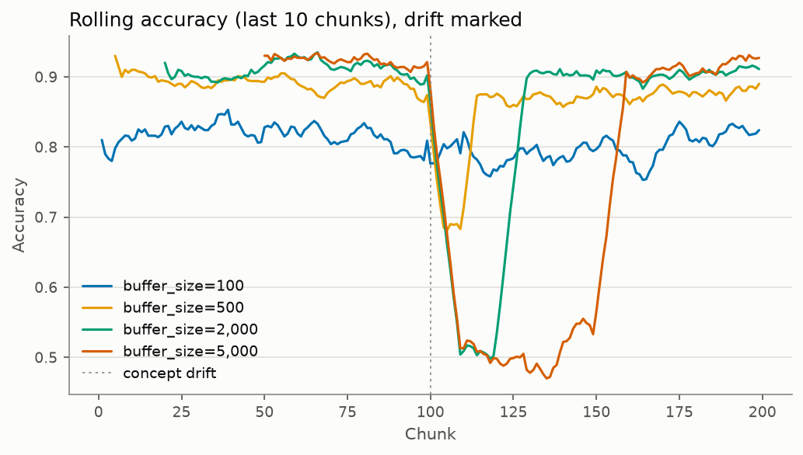
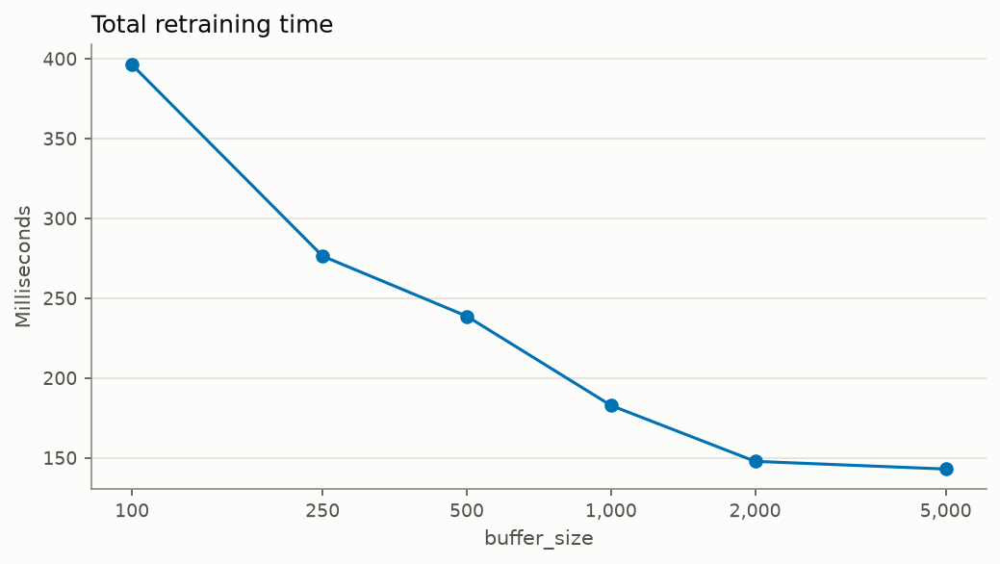
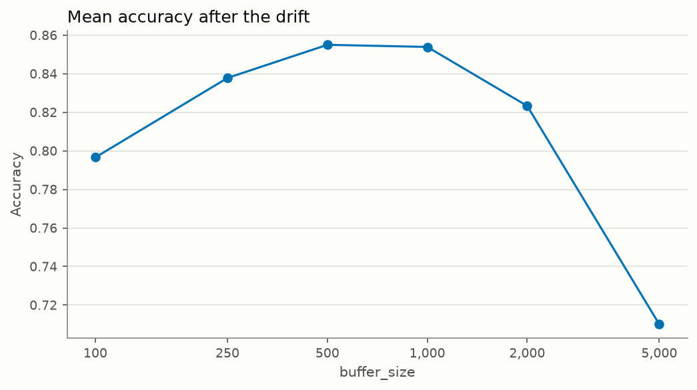

# Streaming benchmark results

Generated by `python -m benchmark.run_stream_benchmarks` (seed 42, 11.8 s in total).

## Environment

- python: 3.14.7
- numpy: 2.5.4
- os: Windows-11-10.0.26200-SP0
- cpu: Intel64 Family 6 Model 154 Stepping 4, GenuineIntel
- cpu_count: 12

## Loop vs vectorised

Median time per call over 7 repeats. Both versions run the same algorithm and are checked to give the same result before they are timed; the speed-up is loop time / NumPy time.

| Operation | NumCompute result | Baseline/result | Notes |
|---|---:|---:|---|
| tree root split (max_depth=1) n=5,000 d=5 | 11.377 ms | 36.694 ms (3.2x) | Sort once per feature, then sweep thresholds with running counts: Python lists vs cumsum |
| tree fit max_depth=5 n=5,000 d=5 | 38.637 ms | 158.445 ms (4.1x) | Same tree (export_text checked); only the split search differs |
| tree predict n=20,000 | 2.236 ms | 16.935 ms (7.6x) | Each row walks the tree vs index arrays moving one level at a time |
| streaming mean/var 100,000 x 5 in chunks of 1,000 | 30.087 ms | 132.784 ms (4.4x) | Welford per value vs one Chan/Welford merge per chunk |

## buffer_size sweep

`demo/data/stream.csv` (20,000 rows, concept drift at chunk 100) in chunks of 100, through SimpleImputer -> StandardScaler -> DecisionTreeClassifier(max_depth=5), evaluated test-then-train with StreamTrainer (each chunk is scored before the model learns from it). Retraining times are the median of 3 run(s); rows left in the buffer at the end are not flushed. Buffer between retrains is the largest buffer logged after a chunk, once any retrain has cleared it; just before each retrain the buffer holds buffer_size rows (rounded up to whole chunks) at 48 bytes each, e.g. 23.4 kB for 500.

| buffer_size | Retrains | Total retrain time | Mean retrain time | Final cumulative accuracy | Mean accuracy after drift | Buffer between retrains |
|---:|---:|---:|---:|---:|---:|---:|
| 100 | 200 | 396.3 ms | 1.98 ms | 0.808 | 0.797 | 0.0 kB |
| 250 | 66 | 276.4 ms | 4.19 ms | 0.853 | 0.838 | 9.4 kB |
| 500 | 40 | 238.8 ms | 5.97 ms | 0.872 | 0.855 | 18.8 kB |
| 1,000 | 20 | 182.9 ms | 9.14 ms | 0.877 | 0.854 | 42.2 kB |
| 2,000 | 10 | 147.8 ms | 14.78 ms | 0.862 | 0.823 | 89.1 kB |
| 5,000 | 4 | 143.0 ms | 35.76 ms | 0.781 | 0.710 | 229.7 kB |

## Figures

